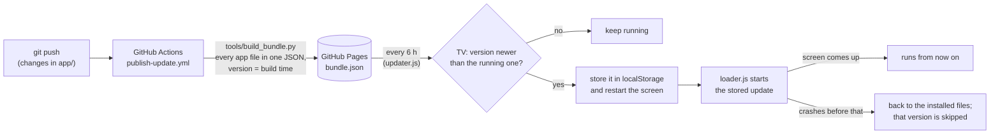

# theme_tv

A clean, ad-free home screen for LG webOS TVs: a clock, weather and crypto cards, and a grid with only the
apps you choose, in 22 looks, over a Baroque gallery or a wood fire if you like. It updates itself from this
repo. Built and tested from a Mac with Docker, packaged and installed with LG's
[webOS CLI](https://webostv.developer.lge.com/develop/tools/cli-introduction) (`@webos-tools/cli`).

```
app/                    the webOS web app (ES5 and plain CSS, so it also runs on webOS 3 / Chromium 38)
  index.html            only starts loader.js
  loader.js             loads the installed files, or a newer update from GitHub
  version.js            the installed version (its build time)
  appinfo.json          app id, title, icons, permissions
  config.js             settings: language, favorite apps, theme, wallpaper, cities, crypto, updates
  i18n.js               the screen's text in Spanish and English
  layout.js             the screen's markup
  tv.js                 Luna calls on the TV; sample apps in a desktop browser
  widgets.js            weather (Open-Meteo) and crypto (CoinGecko) cards
  header.js             Developer Mode countdown and renewal
  wallpaper.js          Baroque gallery and fireplace
  updater.js            checks GitHub for updates
  main.js               the screen: clock, grid, themes, navigation, launch transition
  styles.css            layout and the modern dark look
  themes.css            the other looks
  wallpaper.css         the wallpapers
  baroque.js            100 Baroque paintings (generated, see below)
  devmode.js            Developer Mode session, filled in by install-tv
tools/
  install-tv.sh         installs on the TV and renews Developer Mode (runs in the cli image)
  devmode-session.mjs   renews a Developer Mode session with LG
  build_bundle.py       builds the update the TVs download
  fetch_baroque.py      writes app/baroque.js from Wikidata
  make_icons.py         draws app/icon.png and app/largeIcon.png
.github/workflows/
  publish-update.yml    publishes the update on GitHub Pages on every push that changes app/
```

## Settings

All in `app/config.js`:

- `language`: `es`, `en`, or `auto` (the TV's). Every text on screen is in `app/i18n.js`.
- `favorites`: the apps on the home screen, in order, by app id or part of the name. An empty list shows every
  app. After the favorites, one tile opens all the apps on the TV and another the theme picker.
- `theme`: the first look. Pick another from the "Theme" tile, or cycle with the remote's blue button (T in a
  browser); the TV remembers the choice (localStorage), so `theme` only applies until one is picked.
- `autoTheme`: the `auto` theme's day and night looks and hours.
- `weather`: one card per city, by coordinates (Open-Meteo, no key).
- `crypto`: the top `count` coins by market cap in `currency`, stablecoins and wrapped tokens left out
  (CoinGecko, no key). The last prices are kept for when the network fails.
- `wallpaper`: `none`, `baroque` (a painting in a gilt frame, a new one every `artMinutes`) or `fireplace`.
  Pick one from the "Wallpaper" tile. The yellow button (A in a browser) shows it alone, and so does
  `idleMinutes` without a key; any key brings the screen back.
- `devMode`: the Developer Mode countdown, and how many days before the end it renews on its own.
- `update`: where the TV looks for updates, and how often.
- `launchAnimation`: opening an app zooms its tile until it fills the screen.

Themes: `dark`, `swiss`, `brutal`, `glass`, `pastel`, `immersive` (3D), `skeuo`, `metro`, `neumorph`, `clay`,
`material`, `editorial`, `eink`, `synthwave`, `cyberpunk`, `teletext`, `terminal`, `pixel`, `artdeco`, and two
that also change the layout: `bento` (the first favorite big) and `carousel` (one row, focused tile in the
middle). `auto` switches between two of them by the hour.

## Preview on the Mac

```bash
docker compose up -d --build preview
```

Open http://localhost:8080. Edits in `app/` show up on refresh. In a browser, sample apps stand in for the
TV's and opening one is simulated. Arrows and Enter act as the remote; Escape or Backspace act as Back.
`?theme=<id>` and `?lang=<code>` in the address force a theme or a language.

## Install on the TV

Once, on the TV: install the Developer Mode app from the LG Content Store, sign in with an LG developer account
(webostv.developer.lge.com), turn on Dev Mode Status and Key Server, and note the IP and passphrase.

```bash
make setup_tv IP=192.168.1.50 PASS=ABC123   # once: register the TV and fetch its key
make install_tv                             # install or update, renewing Developer Mode on the way
```

The `Makefile` runs the Docker commands; `make preview`, `make stop` and `make package` cover the rest.

`install-tv` reads the TV's Developer Mode session token, checks the session with LG (renewing it when under
7 days are left), and packages the app with
the token and the session's end (`app/devmode.js`, in the package only). The home screen then shows the days
left and renews on its own when few are left; OK on the countdown renews it, or opens LG's Developer Mode app
if the TV blocks the request. The registered TV and its key persist in the `ares-config` volume.

Notes:

- `@webos-tools/cli` 3.2.6 needs Node.js 20 or newer, whatever LG's install page says; the image uses Node 20.
- `ares-package` warns that `appinfo.json` has no `requiredACG`. LG enforces it only from webOS 26, and only
  when the field is there; it lists no group for `listLaunchPoints`, which the app needs, so it is left out.

## Updates

Pushing a change to `app/` on `main` is releasing it: the TVs pick it up on their own, without a reinstall.



- The installed files never change: `loader.js` decides at each start whether to run them or the stored update.
  `index.html` and `loader.js` themselves cannot update this way; changing them needs `install-tv`.
- `app/devmode.js`, written per TV by `install-tv`, always comes from the installed files.
- `install-tv` stamps the install time as the version, so a TV only takes updates pushed after it was installed.
- The workflow publishes on GitHub Pages rather than committing, so the repo keeps only its authors' commits.

## Package only

```bash
docker build --target ipk --output dist .      # dist/theme-tv.ipk
docker compose run --rm --build cli            # package info (ares-package --info)
```

## Baroque paintings

`app/baroque.js` lists the 100 best-known Baroque paintings: those whose painting or painter belongs to a
Baroque movement, made 1590-1760, ranked by how many Wikipedias have an article on them (Wikidata). The images
are public domain, on Wikimedia Commons. `FIXES` in the script corrects wrong or vandalized Wikidata entries.

```bash
python3 tools/fetch_baroque.py
```
